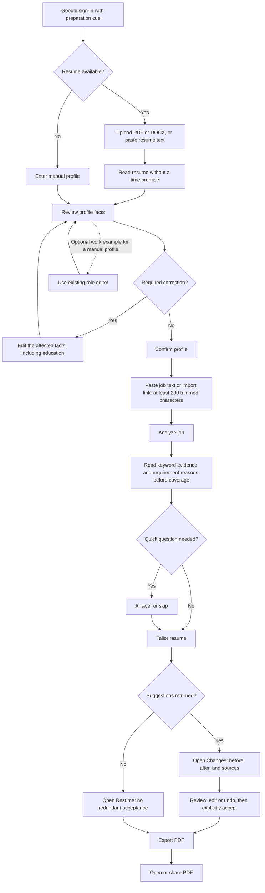

# First-use activation evidence

This record covers the ten changes in [the approved delta](README.md).
The screenshots use synthetic repository fixtures and Robolectric/Roborazzi.
They are test captures, not emulator captures or evidence of user-perceived value.

## Implemented flow



The tailoring control uses the repository-confirmed credit balance. An unknown balance blocks it. A confirmed zero opens the existing credit flow. A successful run uses one credit, including a successful run with no changes. A failed run does not add a client debit. Production refreshes the server-owned ledger. Demo records the local spend.

## Validation

`tools/ci/verify-local.sh` exited 0 on 2026-10-12. The final Gradle run reported:

```text
BUILD SUCCESSFUL in 1m 20s
2166 actionable tasks: 165 executed, 5 from cache, 1996 up-to-date
```

- [Full passing output](evidence/verify-local.txt). Local workspace and home path prefixes were replaced. Trailing whitespace was removed.
- [JUnit report counts by task](evidence/test-results.csv). These are local report counts, not user metrics. Cached tasks can retain reports from the earlier passing focused run.
- Passed: constitution, secret-scan test harness, release-configuration tests, workflow tests, formatting, unit tests, coverage, screenshot verification, lint, Dependency Guard, and demo/prod debug/release builds.
- Recorded and verified 27 changed screenshot baselines. Representative changed screens were visually inspected at normal and 200% font sizes.
- Independent review found and resolved education continuation metadata, omitted requirement reasons, and recovery after a failed credit refresh.
- Earlier runs exposed stale assertions, test fixtures, two missing test imports, a plural-resource lint issue, and education input clipping. The final run passes after those fixes.

## Behavior evidence

| Behavior | Runnable evidence |
|---|---|
| Preparation cue and removal of the unmeasured import estimate | [SignInScreenTest](../../feature/onboarding/impl/src/test/kotlin/com/tailormyresume/feature/onboarding/impl/signin/SignInScreenTest.kt), [ReadingScreenTest](../../feature/onboarding/impl/src/test/kotlin/com/tailormyresume/feature/onboarding/impl/reading/ReadingScreenTest.kt) |
| Required corrections, optional manual work example, and education navigation | [ReviewRouteNavigationTest](../../feature/onboarding/impl/src/test/kotlin/com/tailormyresume/feature/onboarding/impl/review/ReviewRouteNavigationTest.kt), [ReviewMapperTest](../../feature/onboarding/impl/src/test/kotlin/com/tailormyresume/feature/onboarding/impl/review/ReviewMapperTest.kt) |
| Education preserves structured values, IDs, bullets, and continuation groups | [ListEditViewModelTest](../../feature/profile/impl/src/test/kotlin/com/tailormyresume/feature/profile/impl/listedit/ListEditViewModelTest.kt#L210) |
| Job minimum and evidence-first order | [JobScreenTest](../../feature/analysis/impl/src/test/kotlin/com/tailormyresume/feature/analysis/impl/job/JobScreenTest.kt), [JobResultScreenshotTest](../../feature/analysis/impl/src/test/kotlin/com/tailormyresume/feature/analysis/impl/result/JobResultScreenshotTest.kt#L120) |
| Nonblank reasons remain visible | [JobResultViewModelTest](../../feature/analysis/impl/src/test/kotlin/com/tailormyresume/feature/analysis/impl/result/JobResultViewModelTest.kt) |
| Credit source, unknown versus zero, account isolation, and failed refresh recovery | [AccountCreditBalanceTest](../../core/domain/src/test/kotlin/com/tailormyresume/core/domain/account/AccountCreditBalanceTest.kt), [OfflineFirstCreditsRepositoryRemoteTest](../../core/data/src/test/kotlin/com/tailormyresume/core/data/repository/OfflineFirstCreditsRepositoryRemoteTest.kt) |
| Success spends once; failure and retry preserve spend semantics | [TailoringRunnerTest](../../feature/tailor/impl/src/test/kotlin/com/tailormyresume/feature/tailor/impl/tailoring/TailoringRunnerTest.kt) |
| Changes opens first and Resume stays one tap away | [TailoredScreenshotTest](../../feature/tailor/impl/src/test/kotlin/com/tailormyresume/feature/tailor/impl/result/TailoredScreenshotTest.kt#L158) |
| Suggestions require acceptance; no-change export needs no acceptance | [TailoredViewModelTest](../../feature/tailor/impl/src/test/kotlin/com/tailormyresume/feature/tailor/impl/result/TailoredViewModelTest.kt#L77), [TailoredUndoTest](../../feature/tailor/impl/src/test/kotlin/com/tailormyresume/feature/tailor/impl/result/TailoredUndoTest.kt#L49) |

## All changed screenshots

The normal prototype size is 374 × 834 dp. The narrow variant uses 337 dp width and 200% font size.
Each image remains in its existing test-baseline location. No duplicate image files are added.

### Onboarding

- [reading_0_prototype_dark](../../feature/onboarding/impl/src/test/screenshots/reading_0_prototype_dark.png)
- [reading_100_prototype_dark](../../feature/onboarding/impl/src/test/screenshots/reading_100_prototype_dark.png)
- [reading_40_prototype_dark](../../feature/onboarding/impl/src/test/screenshots/reading_40_prototype_dark.png)
- [review_fixed_narrow-337-font-200_dark](../../feature/onboarding/impl/src/test/screenshots/review_fixed_narrow-337-font-200_dark.png)
- [review_fixed_prototype_dark](../../feature/onboarding/impl/src/test/screenshots/review_fixed_prototype_dark.png)
- [review_linkedin_added_prototype_dark](../../feature/onboarding/impl/src/test/screenshots/review_linkedin_added_prototype_dark.png)
- [review_needs_fix_narrow-337-font-200_dark](../../feature/onboarding/impl/src/test/screenshots/review_needs_fix_narrow-337-font-200_dark.png)
- [review_needs_fix_prototype_dark](../../feature/onboarding/impl/src/test/screenshots/review_needs_fix_prototype_dark.png)
- [signin_cancelled_toast_prototype_dark](../../feature/onboarding/impl/src/test/screenshots/signin_cancelled_toast_prototype_dark.png)
- [signin_signing_in_prototype_dark](../../feature/onboarding/impl/src/test/screenshots/signin_signing_in_prototype_dark.png)
- [signin_story1_prototype_dark](../../feature/onboarding/impl/src/test/screenshots/signin_story1_prototype_dark.png)
- [signin_story2_prototype_dark](../../feature/onboarding/impl/src/test/screenshots/signin_story2_prototype_dark.png)
- [signin_story3_prototype_dark](../../feature/onboarding/impl/src/test/screenshots/signin_story3_prototype_dark.png)

### Profile

- [editors_list_education_narrow-337-font-200_dark](../../feature/profile/impl/src/test/screenshots/editors_list_education_narrow-337-font-200_dark.png)
- [editors_list_education_prototype_dark](../../feature/profile/impl/src/test/screenshots/editors_list_education_prototype_dark.png)

### Analysis

- [job_empty_narrow-337-font-200_dark](../../feature/analysis/impl/src/test/screenshots/job_empty_narrow-337-font-200_dark.png)
- [job_empty_prototype_dark](../../feature/analysis/impl/src/test/screenshots/job_empty_prototype_dark.png)
- [job_notAJobPost_narrow-337-font-200_dark](../../feature/analysis/impl/src/test/screenshots/job_notAJobPost_narrow-337-font-200_dark.png)
- [job_notAJobPost_prototype_dark](../../feature/analysis/impl/src/test/screenshots/job_notAJobPost_prototype_dark.png)
- [result_job_analyzed_credits_narrow-337-font-200_dark](../../feature/analysis/impl/src/test/screenshots/result_job_analyzed_credits_narrow-337-font-200_dark.png)
- [result_job_analyzed_credits_prototype_dark](../../feature/analysis/impl/src/test/screenshots/result_job_analyzed_credits_prototype_dark.png)
- [result_job_analyzed_nocredits_narrow-337-font-200_dark](../../feature/analysis/impl/src/test/screenshots/result_job_analyzed_nocredits_narrow-337-font-200_dark.png)
- [result_job_analyzed_nocredits_prototype_dark](../../feature/analysis/impl/src/test/screenshots/result_job_analyzed_nocredits_prototype_dark.png)

### Tailor

- [result_export_disabled_toast_prototype_dark](../../feature/tailor/impl/src/test/screenshots/result_export_disabled_toast_prototype_dark.png)
- [result_resume_with_answer_narrow-337-font-200_dark](../../feature/tailor/impl/src/test/screenshots/result_resume_with_answer_narrow-337-font-200_dark.png)
- [result_resume_with_answer_prototype_dark](../../feature/tailor/impl/src/test/screenshots/result_resume_with_answer_prototype_dark.png)
- [result_resume_without_answer_prototype_dark](../../feature/tailor/impl/src/test/screenshots/result_resume_without_answer_prototype_dark.png)

## Supporting flow screenshots

These existing frames show the preserved path around the changed states.
The no-change branch has behavioral tests above; this evidence does not claim a new no-change screenshot.

- [upload_prototype_dark](../../feature/onboarding/impl/src/test/screenshots/upload_prototype_dark.png)
- [manual_prototype_dark](../../feature/onboarding/impl/src/test/screenshots/manual_prototype_dark.png)
- [result_changes_before_accept_prototype_dark](../../feature/tailor/impl/src/test/screenshots/result_changes_before_accept_prototype_dark.png)
- [result_accepted_prototype_dark](../../feature/tailor/impl/src/test/screenshots/result_accepted_prototype_dark.png)
- [export_exported_free_prototype_dark](../../feature/tailor/impl/src/test/screenshots/export_exported_free_prototype_dark.png)

## Scope and limits

The constitution amendment adds the approved activation delta to the screenshot acceptance source. The gate is unchanged. Product integrity rules I.1–I.5 are unchanged. The exported prototype is unchanged. No lint suppression, dependency, or analytics SDK was added.

No emulator data was changed. No real candidate data, purchase, device installation, or production request was used. Live backend behavior and PDF opening in an external Android app were not checked in this implementation run. Build time and demo behavior do not establish production latency. These tests do not prove that a user recognizes the proposed aha moment.
