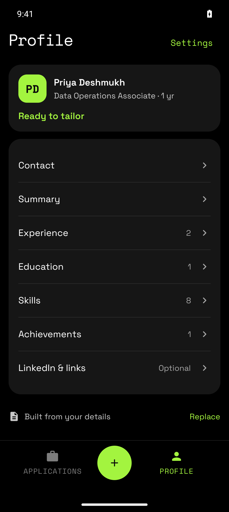
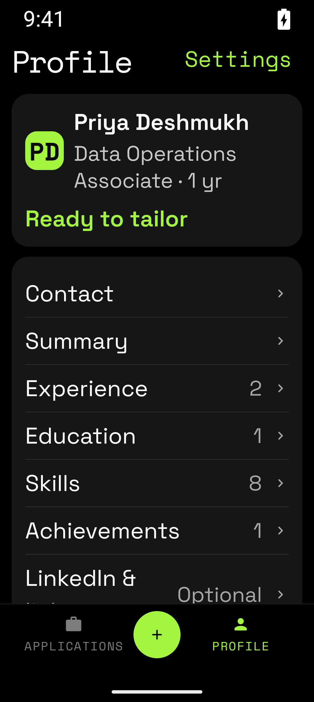
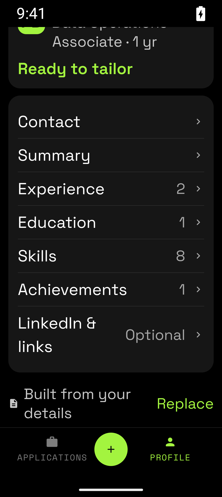
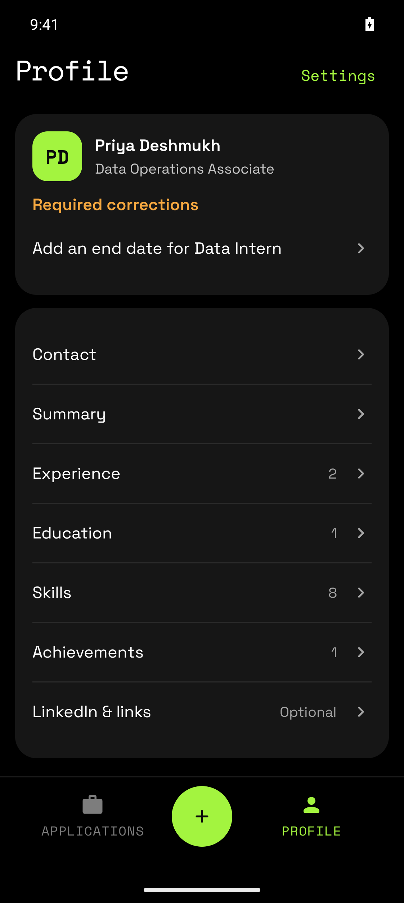
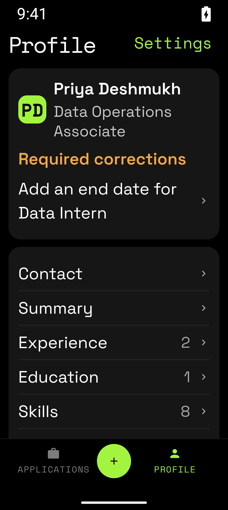

# Profile readiness — issue #392

The later Profile screen now shows **Ready to tailor** when the profile has no required gaps. The percentage and progress bar are removed from this screen. Missing experience end dates appear under **Required corrections**. Each correction opens the affected role in the existing editor.

**LinkedIn & links** is labelled **Optional** in secondary text. Links do not affect readiness. The first-use review, required-gap rule, explicit confirmation, profile storage, and export acceptance checks stay unchanged. Readiness in later Profile use does not add a review-timestamp requirement. No backend or API contract change is required.

The source is [issue #392](https://github.com/BengaluruBuilders/tailor-my-resume/issues/392). The [published before screenshot](https://raw.githubusercontent.com/BengaluruBuilders/tailor-my-resume/95066b23eb65a831607b5b40575854c49ff8371f/design/audits/2026-10-16/screenshots/27-profile.png) shows the 96% score and amber Add tag.

## Results

The corrected focused build passed with warnings treated as errors. All 167 Profile module tests passed, including five focused screenshot tests that verify six captures. A regression test covers a confirmed profile without a first-use review timestamp, matching the Dev console's sample data.

Native interaction passed on a private Android API 36 emulator at 1122 × 2502 px, density 480 (374 dp wide), with system font scales 1.0 and 2.0:

- The sample profile shows **Ready to tailor** and **Optional** for links at both text sizes.
- Removing the Data Intern role's end date shows **Required corrections** and its named correction at both text sizes.
- The correction opens the Data Intern editor. Restoring the end date restores **Ready to tailor**.
- The optional links row still opens Contact, whose LinkedIn field remains labelled optional.

The five captures were visually inspected. Text wraps without clipping, and the links row remains reachable by scrolling at 200%. The private emulator was shut down after the pass. Full repository gate and CI results are recorded in [PR #400](https://github.com/BengaluruBuilders/tailor-my-resume/pull/400).

| Ready, normal | Ready, 200% | Optional links, 200% |
|---|---|---|
|  |  |  |

| Required correction, normal | Required correction, 200% |
|---|---|
|  |  |

## Coverage

- ViewModel checks cover readiness with and without optional URLs, required gaps, and a confirmed profile without a first-use review timestamp.
- Real entry tests cover the affected role editor and Contact navigation, with the stored profile unchanged by each navigation action.
- Profile screenshot checks cover ready and required-correction states at the prototype size and at 337 dp with 200% text. They assert that text is not clipped or ellipsized. The optional links row also has a scrolled 200% capture.

## Validation environment

Validation initially used the shared legacy lock. After the owner updated resource coordination, the queued work moved to `.worktrees/run-validation` with two shared slots and one operation per worktree. New runs use two Gradle workers, a 2 GB Gradle heap, two active processors, and single-use daemons. The emulator uses the coordinator’s exclusive emulator slot, 2 GB RAM, and two CPU cores. Two Gradle invocations stalled while configuring projects in parallel. Thread dumps show the root and included-build configuration workers waiting in `TaskPathProjectEvaluator.scheduleProjectsJustInTime`. Disabling parallel configuration-cache operations alone did not resolve it. The final invocation adds `-Dorg.gradle.internal.isolated-projects.parallel=false` with `-Dorg.gradle.configuration-cache.parallel=false`. Isolated projects, configuration cache, and all quality gates remain enabled. No repository or shared Gradle setting changed.

The emulator APK uses command-line preview overrides: staging API `https://127.0.0.1:1/` and blank staging Firebase client properties (`WebClientId`, `FirebaseApiKey`, `FirebaseAppId`, `FirebaseProjectId`). This preserves synthetic sample sessions as in the original audit. These captures do not verify live authentication, AI, credits, billing, or the staging backend. The full repository gate uses the existing configured environment.

## Focused render command

Run from this issue's worktree. The full gate uses `tools/ci/verify-local.sh` through the same coordinator, with equivalent daemon, heap, processor, worker, and parallel-configuration limits supplied in the environment.

```bash
../run-validation build 392 ./gradlew \
  :feature:profile:impl:spotlessApply \
  :feature:profile:impl:verifyRoborazziDebug \
  :feature:profile:impl:testDebugUnitTest :app:assembleDebug \
  -Dorg.gradle.internal.isolated-projects.parallel=false \
  -Dorg.gradle.configuration-cache.parallel=false \
  -PwarningsAsErrors=true \
  -PtailormyresumeStagingApiBaseUrl=https://127.0.0.1:1/ \
  -PtailormyresumeStagingWebClientId= \
  -PtailormyresumeStagingFirebaseApiKey= \
  -PtailormyresumeStagingFirebaseAppId= \
  -PtailormyresumeStagingFirebaseProjectId= \
  --no-daemon --max-workers=2 --console=plain \
  '-Dorg.gradle.jvmargs=-Xmx2g -XX:MaxMetaspaceSize=768m -XX:ActiveProcessorCount=2 -Dfile.encoding=UTF-8'
```
