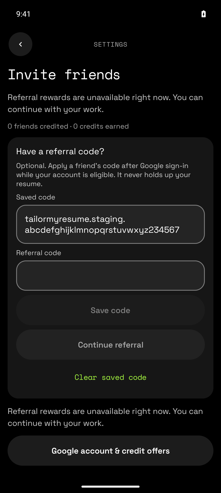
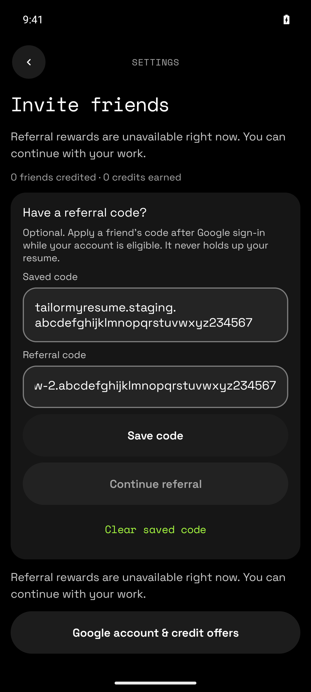
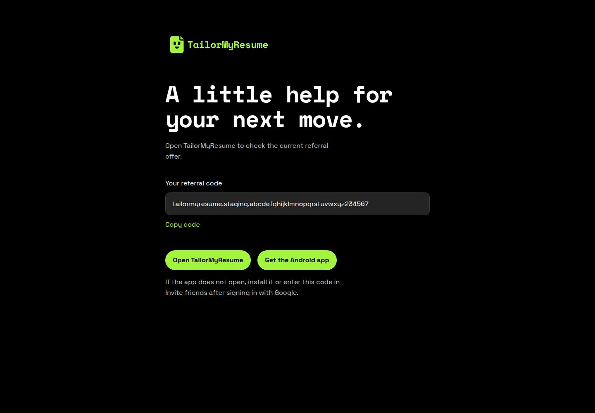

# Slice04 published evidence

**External acceptance blocked; not ready for merge.** Independent attainable implementation/repository/fixture/device checks PASS; R04-V001 platform acceptance and R04-V002 exact configured-origin/deployed publication coupling remain BLOCKED. This is pre-publication evidence, not a post-PR verdict or release claim.

Tested implementation: FE `a86e8e3ab7354acab6cb5c78309adb09f91c3796` / BE `a67d2ad56330c5522235bd4e1ae526b0cf5e3412`. Evidence commits contain documentation/assets only and preserve these implementation bytes. Contract `referral-links-v1`, section 11, SHA256 `5f1ee690c0a0ff7aed487f468400a4181a4298286210e492e18887cd9fa6f803`.

[Independent findings](findings.md), [24-case acceptance map](independent-evidence/acceptance-results.json), [actual gate results](independent-evidence/gates-and-stop-summary.json), [bounded file hashes](independent-evidence/evidence-manifest.json), [runtime observations](independent-evidence/runtime-smoke.md), [browser observations](independent-evidence/landing-browser.md), [request provenance boundary](request-provenance-decision.md), [browser accommodation](landing-harness-decision.md).

Backend `npm run check`: 772/772 PASS, zero skips, actual PostgreSQL and injected Firebase/Integrity; [route/transaction/erasure/restore log](independent-evidence/backend-check.log). Frontend required unchanged `verify-local.sh`: PASS, 35 tasks executed/2030 up-to-date; retained matching-source XML 511 suites/2884 tests, zero failures/skips, explicitly reused rather than claimed fresh. [Full gate log](independent-evidence/frontend-verify.log). Real scanner harness 28 cases executed; [source scan](independent-evidence/frontend-source-scan.log), [backend history scan](independent-evidence/backend-history-scan.log), [frozen contract verifier](independent-evidence/contract-verifier.log). No full suite rerun for this documentation-only publication.

The browser harness substitutes exactly one reversible HTML origin attribute; every script/asset/offer byte stays unchanged. [Literal substitution/hash/reversal proof](independent-evidence/landing-harness-proof.json) and [fallback cases](independent-evidence/landing-fallback-results.json). It proves loopback rendering, not configured HTTPS hosting, resolver association or deployed cache coupling. Android component-forced VIEW tests are synthetic and cannot prove real App Links, Play, Google/Integrity or rewards. Candidate contact is temporally correlated, not decoded authenticated HTTP success. Default APK alone upgraded the actual Pixel with data preserved; fixture APK only ran on the disposable emulator. Runtime resources were cleaned and existing services preserved.

## Inspected real screenshots

All five images were visually inspected for privacy before publication. Synthetic codes only; no personal resume/account details. Every caption below applies to the exact FE/BE pair above; per-image hashes, APK hashes, variants and exact pair are in [screenshot manifest](independent-evidence/screenshots-manifest.json).

Synthetic fixture APK, forced cold VIEW to MainActivity: saved LINK code with neutral unavailable offer; no resolver/Play/Google/Integrity/reward proof. Tested FE `a86e8e3ab7354acab6cb5c78309adb09f91c3796` / BE `a67d2ad56330c5522235bd4e1ae526b0cf5e3412`.

Synthetic fixture APK/warm forced different-code VIEW: first candidate and synthetic unsaved editor draft retained. Tested FE `a86e8e3ab7354acab6cb5c78309adb09f91c3796` / BE `a67d2ad56330c5522235bd4e1ae526b0cf5e3412`.

Actual IAB Chromium1440x1000: current conditional5-credit copy and fixed store controls; same declared one-attribute loopback accommodation. Tested FE `a86e8e3ab7354acab6cb5c78309adb09f91c3796` / BE `a67d2ad56330c5522235bd4e1ae526b0cf5e3412`.

Actual SAME IAB tab14:27:10Z, no reload/clock/file changes: expired numeric offer becomes neutral; one-attribute origin accommodation. Tested FE `a86e8e3ab7354acab6cb5c78309adb09f91c3796` / BE `a67d2ad56330c5522235bd4e1ae526b0cf5e3412`.

Actual IAB Chromium390x844: current conditional5-credit copy. Generated JS/assets/offer unchanged; one documented harness-only HTML origin substitution, loopback HTTP. Tested FE `a86e8e3ab7354acab6cb5c78309adb09f91c3796` / BE `a67d2ad56330c5522235bd4e1ae526b0cf5e3412`.

## Publication omissions

This compact selection omits APKs, private client/runtime configuration, raw relay/device/syscall artifacts, huge per-file source checksum manifests, generated fixture ZIP and duplicate/diagnostic screenshots. Reports retain the validator’s original bounded observations; omitted local artifacts are not represented as GitHub attachments. Original-source all-input rehash verification is reported in findings; no fabricated source hashes or scanner exceptions were added. Private transport labels were redacted from publication copies. Prior setup failures remain disclosed in findings/gate summary; final successful logs are included.
