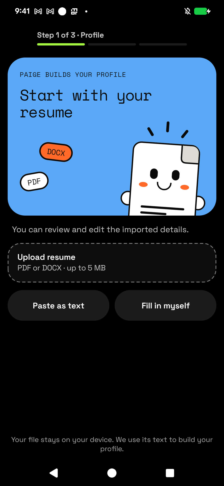
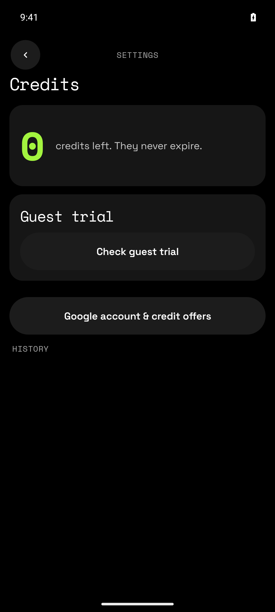
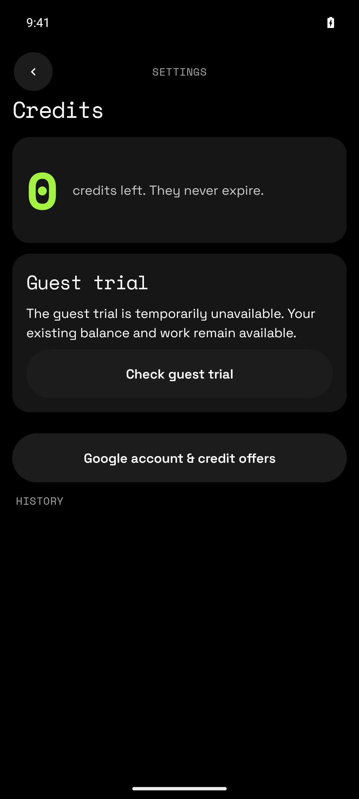
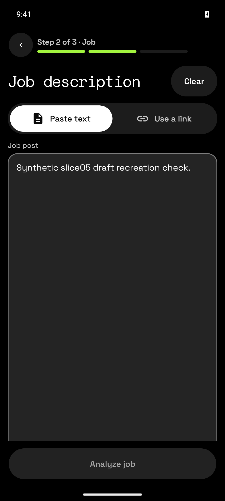

# Publication evidence — slice05

**External acceptance blocked; not ready for merge or release.** Independent attainable gates PASS with zero actionable findings. This directory is an evidence-only addition after validated executable FE `6b4a55b1d1bb9c9bd7e02e027de9967d97032235` / BE `694ec866da51d64c0f766dc95989daec891ee84d`. Previous FE evidence head `e6208203d888bd8995a8cef36155e7c8ff7fa6e9` adds exactly four evidence files. Final publication heads are recorded in the PR descriptions.

[Twenty-case findings](findings.md) · [Required check/source/APK mapping](independent-evidence/candidate-gates.json) · [Runtime and limits](independent-evidence/runtime-smoke.md) · [Screenshot hash manifest](independent-evidence/screenshots.json) · [External gate disposition](../external-gate-decision.md)

All five images below are actual signed runtime captures (491,392 bytes total), inspected and approved by the independent validator. Each uses the exact executable pair above. No generated UI, APK, raw logs, private configuration or exploratory unsent-draft/return capture is included.

Actual Pixel7Pro default staging upgrade preserves the existing empty resume import screen; package/signer checked and install-r succeeded. No account/data mutation. Tested FE `6b4a55b1d1bb9c9bd7e02e027de9967d97032235` / BE `694ec866da51d64c0f766dc95989daec891ee84d`.

Actual signed staging Credits shows zero credits with guest/account earning entry and history; no new-sale or manual-restore controls. Existing synthetic guest. Tested FE `6b4a55b1d1bb9c9bd7e02e027de9967d97032235` / BE `694ec866da51d64c0f766dc95989daec891ee84d`.

Actual Check guest trial result is neutral temporarily unavailable; zero balance/work retained. No claim or reward occurred. Tested FE `6b4a55b1d1bb9c9bd7e02e027de9967d97032235` / BE `694ec866da51d64c0f766dc95989daec891ee84d`.

Actual Check offers again remains neutral unavailable and usable; timed action correlates with exact candidate contact, not decoded response/reward proof. Tested FE `6b4a55b1d1bb9c9bd7e02e027de9967d97032235` / BE `694ec866da51d64c0f766dc95989daec891ee84d`.

Actual synthetic unsent editor text survives landscape/portrait Activity rotation. Text was then cleared; no Analyze/paid call. Does not prove process-death persistence. Tested FE `6b4a55b1d1bb9c9bd7e02e027de9967d97032235` / BE `694ec866da51d64c0f766dc95989daec891ee84d`.

